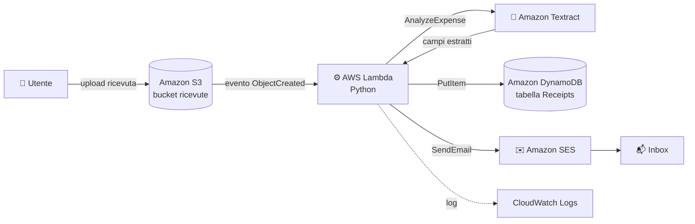

# 🧾 Automated Receipt Processing on AWS

Pipeline **serverless** che elabora automaticamente le ricevute: carichi un'immagine o un PDF su Amazon S3 e, in pochi secondi, i dati (negozio, data, totale, articoli) vengono estratti con AI, salvati in un database e inviati via email.

  

---

## 📐 Architettura



### Flusso

1. Carichi una ricevuta (`.png`, `.jpg`, `.pdf`, `.tiff`) nel bucket S3.
2. S3 genera un evento che avvia la funzione **Lambda**.
3. Lambda chiama **Textract `AnalyzeExpense`**, pensato per ricevute e fatture.
4. I campi estratti vengono salvati in **DynamoDB**.
5. **SES** invia un'email con il riepilogo.
6. Log ed errori finiscono su **CloudWatch**.

### Servizi usati

| Servizio | Ruolo |
|---|---|
| **Amazon S3** | Storage delle ricevute e trigger dell'automazione |
| **AWS Lambda** | Orchestrazione della logica (serverless) |
| **Amazon Textract** | OCR/AI per estrarre dati strutturati |
| **Amazon DynamoDB** | Database NoSQL per i dati estratti |
| **Amazon SES** | Notifiche email |
| **AWS IAM** | Permessi a minimo privilegio per la Lambda |
| **Amazon CloudWatch** | Logging e troubleshooting |


---

## ✅ Prerequisiti

- Un account AWS (il progetto rientra nel **Free Tier**, ma controlla sempre i limiti aggiornati)
- Una regione in cui sono disponibili **Textract** e **SES** (es. `us-east-1`, `eu-west-1`)
- Una casella email a cui hai accesso, per la verifica SES
- (Opzionale) AWS CLI e Python 3.12 per l'uso da terminale

> ⚠️ **Textract `AnalyzeExpense` funziona al meglio su ricevute in inglese.** Sulle ricevute italiane l'estrazione dei campi può essere meno precisa: verifica i risultati.

---

## 🚀 Setup passo-passo (console AWS)

Sostituisci `YOUR_BUCKET_NAME`, `YOUR_REGION` e `YOUR_ACCOUNT_ID` con i tuoi valori.

### 1. Crea il bucket S3
- S3 → **Create bucket** → nome univoco globale (es. `receipts-tuonome-2025`)
- Lascia attivo **Block all public access**

### 2. Crea la tabella DynamoDB
- DynamoDB → **Create table**
- Nome: `Receipts`
- Partition key: `receipt_id` (String)
- Capacity mode: **On-demand**

### 3. Configura Amazon SES
- SES → **Verified identities** → **Create identity** → *Email address*
- Verifica il **mittente** e il **destinatario** cliccando il link ricevuto via email
- Un account SES nuovo è in **sandbox**: puoi inviare solo a indirizzi verificati

### 4. Crea il ruolo IAM per la Lambda
- IAM → **Roles** → **Create role** → *AWS service* → *Lambda*
- Crea una policy inline con il contenuto di [`iam/lambda-execution-policy.json`](iam/lambda-execution-policy.json), sostituendo i segnaposto
- Nome suggerito: `ReceiptProcessorLambdaRole`

### 5. Crea la funzione Lambda
- Lambda → **Create function** → *Author from scratch*
- Runtime: **Python 3.12**
- Execution role: quello creato al punto 4
- Incolla il contenuto di [`src/lambda_function.py`](src/lambda_function.py) → **Deploy**
- **Configuration → General configuration**: timeout **30 secondi**
- **Configuration → Environment variables**:

| Chiave | Valore |
|---|---|
| `DYNAMODB_TABLE` | `Receipts` |
| `SENDER_EMAIL` | email mittente verificata |
| `RECIPIENT_EMAIL` | email destinataria verificata |

### 6. Collega S3 alla Lambda
- Lambda → **Add trigger** → *S3*
- Bucket: il tuo bucket · Event type: **All object create events**
- (Consigliato) Suffix: `.png`, `.jpg` o `.pdf` (un trigger per ogni formato)
- Conferma l'avviso sulla **ricorsione**: la Lambda non scrive nello stesso bucket, quindi non c'è loop

### 7. Testa
Carica un file da [`receipts/`](receipts/) nel bucket:

```bash
aws s3 cp receipts/receipt-01-coffee.png s3://YOUR_BUCKET_NAME/
```

Dovresti vedere: un nuovo item in DynamoDB, una email nella inbox e i log in CloudWatch.

In alternativa usa [`events/s3-put-event.json`](events/s3-put-event.json) come **Test event** dalla console Lambda (il file deve già esistere nel bucket).

---

## 🧾 Ricevute di esempio

La cartella [`receipts/`](receipts/) contiene 5 ricevute **fittizie**, ciascuna in PNG e PDF:

| File | Tipologia | Totale (EUR) |
|---|---|---|
| `receipt-01-coffee` | Bar | 9.79 |
| `receipt-02-grocery` | Supermercato | 25.19 |
| `receipt-03-electronics` | Elettronica | 99.42 |
| `receipt-04-restaurant` | Ristorante | 67.65 |
| `receipt-05-pharmacy` | Farmacia | 23.98 |

Per rigenerarle o personalizzarle:

```bash
pip install -r requirements-dev.txt
python scripts/generate_receipts.py
```

Per testare con ricevute reali, **rimuovi prima dati personali** (numeri di carta, nomi) prima di caricarle su GitHub.

---

## 📦 Esempio di output

**Record in DynamoDB** ([`sample-output/dynamodb-item.json`](sample-output/dynamodb-item.json)):

```json
{
  "receipt_id": "3f0c7a52-9b1e-4c8d-a6f4-2d1b8e7c9a10",
  "vendor": "BAR CENTRALE",
  "date": "2025-03-14",
  "subtotal": "8.90",
  "tax": "0.89",
  "total": "9.79",
  "items": [{ "item": "Espresso", "quantity": "2", "price": "2.40" }]
}
```

**Email di riepilogo**: vedi [`sample-output/email-example.txt`](sample-output/email-example.txt).

> Gli output sono esempi indicativi: i valori reali dipendono da ciò che Textract riconosce.

---

## 🔐 Sicurezza e buone pratiche

- **Minimo privilegio**: restringi le risorse nella policy IAM (bucket e tabella specifici).
- Mantieni il bucket **privato** e valuta la cifratura (SSE-S3 è attiva di default).
- Non committare credenziali AWS né ricevute con dati personali.
- Imposta un **AWS Budget** con allarme per evitare costi imprevisti.

---

## 🛠️ Troubleshooting

| Problema | Causa probabile / soluzione |
|---|---|
| `Log group does not exist` | Al ruolo mancano i permessi `logs:*`, oppure il nome del log group non corrisponde a `/aws/lambda/<nome-funzione>` |
| `AccessDeniedException` (Textract/S3) | Controlla la policy IAM e il nome del bucket |
| `MessageRejected` (SES) | Mittente o destinatario non verificati (sandbox) |
| `KeyError: SENDER_EMAIL` | Variabili d'ambiente non configurate |
| `UnsupportedDocumentException` | Formato non supportato, o PDF multipagina (l'API sincrona gestisce 1 pagina) |
| Timeout | Aumenta il timeout della Lambda a 30 s |
| Campi `Unknown` | Ricevuta poco leggibile o in lingua diversa dall'inglese |

---

## 🧹 Pulizia delle risorse

Per evitare costi, al termine elimina:

1. Svuota ed elimina il **bucket S3**
2. Elimina la **tabella DynamoDB**
3. Elimina la **funzione Lambda** e il relativo **log group**
4. Elimina il **ruolo IAM**
5. Rimuovi le **identità SES** verificate

---

## 🔭 Possibili miglioramenti

- Dead-letter queue (SQS) per gli errori
- PDF multipagina con Textract asincrono (`StartExpenseAnalysis`)
- Infrastruttura come codice (AWS SAM / Terraform / CDK)
- Dashboard delle spese (QuickSight o una web app)
- Categorizzazione automatica con Amazon Bedrock
- Notifica via SNS/Slack invece di (o oltre a) SES

